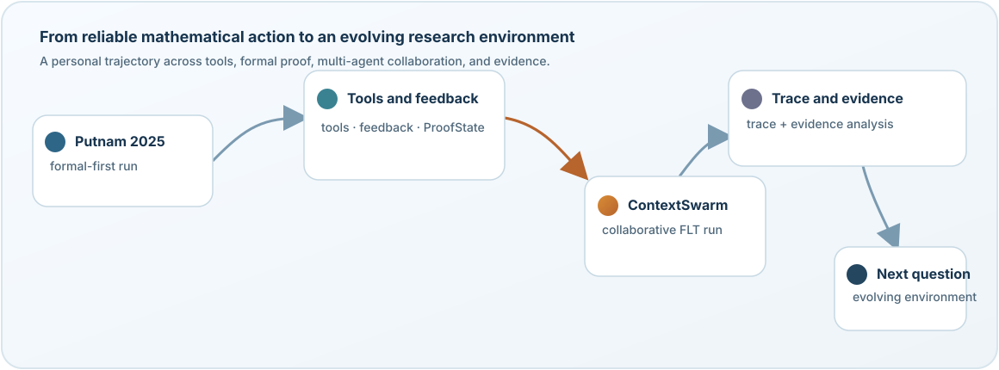

# Chengzhi Yuan · 袁诚志

Undergraduate student at Shanghai Jiao Tong University in Mathematics and Applied Mathematics, pursuing a double degree in Artificial Intelligence (expected 2027).

I study AI systems for formal mathematics: how tools, feedback, structured proof state, and evidence let agents produce, verify, preserve, and continue long-horizon mathematical work.

  <a href="https://yuan-chengzhi.github.io">Personal research website ↗</a>

## Research focus

- **AI for Mathematics and formal proof** — using Lean and machine-checkable artifacts to study how mathematical work can be produced, checked, and continued.
- **Multi-agent systems for long-horizon mathematical tasks** — coordination, structured proof state, tool-mediated communication, graph and network structure, and information flow.
- **Evidence and unfinished work** — how traces, proof objects, feedback, and unresolved obligations should be preserved so that later work can be inspected and inherited.

## Research trajectory

My research began with a concrete question about making an agent reliable on a difficult mathematical task. It then moved through better tools and feedback, a longer formalization campaign with multiple agents, and trace-based analysis of what the system actually preserved. I am now asking how a research environment should evolve as the evidence changes.

  

## Selected work

### ContextSwarm · collaborative FLT formalization

I contributed to the structured proof-state tools (ProofState) and shared information base (CPS), along with prompt and experiment-run improvements, FLTBench issue fixing, and analysis of mathematical progress and system bottlenecks. The campaign targeted a formal reconstruction of Fermat's Last Theorem; the overall formalization remained unfinished.

### Trace analysis · a branch of the same FLT campaign

I analyzed execution traces and experiment data, focusing on the relationships among structured proof state, shared information records, feedback, and shared state. I also contributed figures, proofreading, and manuscript revisions. The analysis is a separate branch of the same campaign rather than an unrelated project.

### Putnam 2025 formal-first experiment

An early experiment with Pi Math First, the Ralph loop, and Pi Lean Tools: 12 problems, eight parallel attempts per problem, and approximately 5.5 hours of total runtime. All 12 problems met the run's apparatus-defined `final_verified` status. This is an internal experiment record, not an official Putnam score or evidence of general mathematical ability.

## Research website

The full research map, project relations, current questions, and public evidence boundaries are maintained at [yuan-chengzhi.github.io](https://yuan-chengzhi.github.io). The public profile is kept deliberately small: each link should point to a repository, result, or record that can be read on its own.

## Current direction

I am exploring how mathematical research environments can preserve useful state without treating every provisional artifact as truth, and how system changes can be evaluated with explicit evidence. The concrete setting may evolve; the recurring interest is in giving capable agents an environment in which their work can be checked, retained, and continued. This remains an open research direction.

Chengzhi Yuan · Shanghai Jiao Tong University · AI4Math · formal mathematics · multi-agent systems
